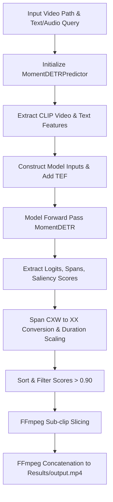

# Project Deep Dive: Moment-DETR Video Moment Retrieval & Highlight Detection Pipeline

> **Technical Architecture Reference & Codebase Analysis**  
> *Target System:* Moment-DETR / QDA-DETR Video Summarization & Localizing Pipeline with CLIP Feature Extraction, Audio/Text Query GUIs, and Automated FFmpeg Video Processing.

---

## 1. Executive Summary

This repository implements an end-to-end, multi-modal **Video Moment Retrieval (MR)** and **Highlight Detection (HD)** system based on **Moment-DETR** (a DETR/Transformer-based neural network architecture extended to 1D temporal domain). Given an input video and a natural language query (provided as text or spoken audio transcribed via Google Speech Recognition), the system identifies relevant temporal spans (start and end timestamps in seconds), scores the frame-level saliency across 2-second video clips, and automatically trims and concatenates the highest-confidence moments into a video summary (`Results/output.mp4`).

### Core Capabilities Reconstructed from Code
1. **Multi-Modal Feature Extraction**: Uses OpenAI CLIP (`ViT-B/32`) to encode 2-second video frames ($0.5\text{ Hz}$ sampling rate) into 512-dimensional visual embeddings and query texts into 512-dimensional sequence embeddings.
2. **Temporal Position Encoding**: Appends normalized 2D Time Embedding Features ($\text{TEF} = [\text{st}/T, \text{ed}/T]$) to visual features, producing a 514-dimensional frame representation.
3. **Transformer Architecture (`MomentDETR`)**: Multi-layer Transformer Encoder-Decoder with 10 learnable moment query embeddings, 1D Sine Positional Encodings, bipartite Hungarian matching, L1/gIoU temporal span regression heads, binary classification head, and a linear saliency scoring head.
4. **Interactive GUI & Audio Query Pipeline**: Tkinter-based desktop interface supporting dual-video playback (input vs. summary), microphone audio recording via `speech_recognition`, text query input, and background execution of inference scripts.
5. **Video Processing & Slicing**: FFmpeg pipe interface for non-blocking frame extraction and FFmpeg CLI execution for sub-clip trimming (`-ss`, `-to`, `-crf 30`) and concatenation (`concat`).

---

## 2. Project Purpose

### Problem Solved
* **Business / Research Problem**: Video content is long, unstructured, and time-consuming to consume. Users need a mechanism to query video archives using natural language or voice commands ("find where the person opens the door") and immediately obtain exact timestamps and a summarized video clip containing only the requested action.
* **Technical Problem**: Joint temporal localization ($[t_{\text{start}}, t_{\text{end}}] \in \mathbb{R}^2$) and frame-level importance estimation ($s_t \in [0, 1]$) from unstructured video streams under variable query sequence lengths and arbitrary video durations without frame-by-frame manual labeling.

### Inputs & Outputs
* **Input**:
  * Unstructured Video File (`.mp4`, `.avi`, `.mov`).
  * Natural Language Text Query (or spoken audio converted to text via Google Speech Recognition).
* **Processing**:
  * Uniform frame extraction at 0.5 FPS (1 frame per 2s clip).
  * CLIP `ViT-B/32` image and text embedding generation.
  * Temporal Feature Concatenation ($\text{CLIP}_{512} + \text{TEF}_2 = 514$).
  * Transformer cross-attention and 1D temporal box regression.
  * Score filtering ($> 0.90$ confidence thresholding).
  * Automated FFmpeg sub-clip extraction and stream concatenation.
* **Output**:
  * Structured predictions JSONL (`pred_relevant_windows`, `pred_saliency_scores`).
  * Processed output video (`Results/output.mp4`).

### Summary Statements

> **One-Line Explanation:**  
> "This system takes a video file and a natural language text or spoken audio query, extracts multi-modal CLIP features, processes them through a Moment-DETR Transformer model to predict temporal start/end timestamps and clip saliency scores, and automatically generates a concatenated highlight video."

> **Technical Explanation:**  
> "The pipeline downsamples input videos to 0.5 Hz using FFmpeg, extracts 512-dim visual embeddings per 2-second clip via CLIP `ViT-B/32`, appends 2D normalized temporal position vectors ($\text{TEF}$), projects text and video features to a 256-dim hidden space, feeds concatenated sequences through a Transformer Encoder-Decoder with 10 query slots, solves Hungarian matching during training with combined $L_1$, temporal $\text{gIoU}$, classification, and margin-based saliency loss, and post-processes inference logits using temporal NMS and clip-alignment before invoking FFmpeg for sub-clip extraction and lossy concatenation."

---

## 3. Repository Structure

### Directory & Component Map

| Component | Path | Purpose | Important Files | Depends On |
| :--- | :--- | :--- | :--- | :--- |
| **Root Entry Points & UIs** | `.` | Execution scripts, Tkinter GUI, config | [gui_audio_text_query_mod.py](file:///c:/Users/vedan/Documents/BE%20PROJECT/gui_audio_text_query_mod.py), [run_audio_query.py](file:///c:/Users/vedan/Documents/BE%20PROJECT/run_audio_query.py), [run_text_query_2.py](file:///c:/Users/vedan/Documents/BE%20PROJECT/run_text_query_2.py), [run.py](file:///c:/Users/vedan/Documents/BE%20PROJECT/run.py) | PyTorch, CLIP, OpenCV, FFmpeg, SpeechRecognition |
| **Moment-DETR Core Model** | `moment_detr/` | DETR neural network, losses, datasets | [model.py](file:///c:/Users/vedan/Documents/BE%20PROJECT/moment_detr/model.py), [transformer.py](file:///c:/Users/vedan/Documents/BE%20PROJECT/moment_detr/transformer.py), [matcher.py](file:///c:/Users/vedan/Documents/BE%20PROJECT/moment_detr/matcher.py), [start_end_dataset.py](file:///c:/Users/vedan/Documents/BE%20PROJECT/moment_detr/start_end_dataset.py), [train.py](file:///c:/Users/vedan/Documents/BE%20PROJECT/moment_detr/train.py), [inference.py](file:///c:/Users/vedan/Documents/BE%20PROJECT/moment_detr/inference.py) | PyTorch, SciPy, NumPy |
| **Video Feature Extraction** | `run_on_video/` | Video frame loader, CLIP wrapper, inference model builder | [data_utils.py](file:///c:/Users/vedan/Documents/BE%20PROJECT/run_on_video/data_utils.py), [model_utils.py](file:///c:/Users/vedan/Documents/BE%20PROJECT/run_on_video/model_utils.py), `clip/` | FFmpeg-python, CLIP, PIL, PyTorch |
| **Evaluation Suite** | `standalone_eval/` | Dataset metrics computation (MR-mAP, MR-R1, HL-mAP, HL-Hit1) | [eval.py](file:///c:/Users/vedan/Documents/BE%20PROJECT/standalone_eval/eval.py), `utils.py` | NumPy, Multiprocessing, SciPy |
| **Utility Modules** | `utils/` | Tensor padding, temporal NMS, file I/O | [basic_utils.py](file:///c:/Users/vedan/Documents/BE%20PROJECT/utils/basic_utils.py), [tensor_utils.py](file:///c:/Users/vedan/Documents/BE%20PROJECT/utils/tensor_utils.py), [temporal_nms.py](file:///c:/Users/vedan/Documents/BE%20PROJECT/utils/temporal_nms.py) | PyTorch, NumPy |
| **Pretrained Checkpoints** | `run_on_video/moment_detr_ckpt/` | Model weights & training options | `model_best.ckpt`, `opt.json` | PyTorch |

### Key Artifact Identification
* **Entry Points**: `gui_audio_text_query_mod.py` (GUI), `run_audio_query.py` (Audio CLI), `run_text_query_2.py` (Text CLI), `run.py` (Example predictor).
* **Main Configuration**: `moment_detr/config.py` (`BaseOptions`, `TestOptions`), `config.json`.
* **Model Checkpoints**: `run_on_video/moment_detr_ckpt/model_best.ckpt` (~16.9 MB / ~57 MB).
* **Generated Artifacts**: `queries.jsonl`, `converted_text.jsonl`, `Results/output_*.mp4`, `Results/video_clips.txt`, `Results/output.mp4`.

---

## 4. System Architecture

```mermaid
flowchart TD
    subgraph UI ["User Interface Layer"]
        A1[Tkinter GUI / CLI Entry Point]
        A2[Microphone Audio Recording]
        A3[Text Query Input]
        A2 -->|Speech Recognition| A4[converted_text.jsonl]
        A3 --> A5[queries.jsonl]
    end

    subgraph FE ["Feature Extraction Layer"]
        B1[Raw Video File .mp4] -->|FFmpeg Pipe 0.5 FPS| B2[Video Frames T x 3 x 224 x 224]
        B2 -->|CLIP Image Encoder| B3[Video Embeddings T x 512]
        A4 & A5 -->|CLIP Text Tokenizer & Encoder| B4[Text Embeddings L x 512]
        B3 -->|Append 2D TEF| B5[Video Features T x 514]
    end

    subgraph ML ["Moment-DETR Model Layer"]
        B5 -->|Linear Projection| C1[Video Tokens T x 256]
        B4 -->|Linear Projection| C2[Text Tokens L x 256]
        C1 & C2 -->|Concat + 1D Sine Pos Embed| C3[Transformer Encoder 2 Layers]
        C3 -->|Encoder Memory| C4[Transformer Decoder 2 Layers]
        C5[10 Learnable Query Slots] --> C4
        C3 -->|Linear Projection| C6[Saliency Scores T]
        C4 -->|MLP Regression Head| C7[Center-Width Spans 10 x 2]
        C4 -->|Linear Class Head| C8[Foreground Logits 10 x 2]
    end

    subgraph PP ["Post-Processing & Output Generation Layer"]
        C7 & C8 -->|Softmax + Span Conversion| D1[Ranked Moments [st, ed, score]]
        D1 -->|Filter score > 0.90 & Top 1 Fallback| D2[Selected Highlight Windows]
        D2 -->|FFmpeg Slice -ss -to| D3[Output Sub-clips Results/output_n.mp4]
        D3 -->|FFmpeg Concat| D4[Final Summary Video Results/output.mp4]
        D4 -->|OpenCV Player| A1
    end
```

---

## 5. End-to-End System Pipeline

```text
Input Video & Query
       ↓
Data Loading & Verification
       ↓
FFmpeg Frame Extraction (0.5 Hz)
       ↓
CLIP Visual & Text Encoding
       ↓
TEF Concatenation & Projection
       ↓
Transformer Encoder-Decoder Inference
       ↓
Logit Softmax & Center-Width Span Decoding
       ↓
Saliency Score Calculation & Rank Sorting
       ↓
Threshold Filtering (score > 0.90)
       ↓
FFmpeg Trimming & Concat
       ↓
GUI Video Player Rendering & Storage
```

### Stage-by-Stage Breakdown

| Pipeline Stage | Input | Processing | Output | File | Function/Class | Key Dependencies |
| :--- | :--- | :--- | :--- | :--- | :--- | :--- |
| **1. Audio / Text Capture** | Spoken speech or text string | Record mic audio via `speech_recognition` or read GUI text widget; save JSONL | `converted_text.jsonl` or `queries.jsonl` | [gui_audio_text_query_mod.py](file:///c:/Users/vedan/Documents/BE%20PROJECT/gui_audio_text_query_mod.py#L95) | `record_audio`, `enter_query` | `speech_recognition`, `json` |
| **2. Frame Extraction** | `.mp4` video file path | `ffmpeg.probe` info, downsample to 0.5 FPS, scale, center-crop $224 \times 224$, stream raw RGB | `torch.Tensor` $[T, 3, 224, 224]$ | [run_on_video/data_utils.py](file:///c:/Users/vedan/Documents/BE%20PROJECT/run_on_video/data_utils.py#L130) | `VideoLoader.read_video_from_file` | `ffmpeg-python`, `numpy`, `torch` |
| **3. Visual Feature Encoding** | Image Tensor $[T, 3, 224, 224]$ | Normalize using CLIP mean/std, mini-batch (bsz=60) CLIP `encode_image` | `torch.Tensor` $[T, 512]$ | [run_on_video/data_utils.py](file:///c:/Users/vedan/Documents/BE%20PROJECT/run_on_video/data_utils.py#L55) | `ClipFeatureExtractor.encode_video` | `run_on_video.clip` |
| **4. Text Feature Encoding** | List of query strings | CLIP BPE tokenizer (context_length=77), CLIP `encode_text`, extract `last_hidden_state` | List of Tensors $[L_i, 512]$ | [run_on_video/data_utils.py](file:///c:/Users/vedan/Documents/BE%20PROJECT/run_on_video/data_utils.py#L70) | `ClipFeatureExtractor.encode_text` | `run_on_video.clip` |
| **5. TEF & Input Projection** | Video $[T, 512]$, Text $[L, 512]$ | Calculate relative time positions $[\frac{i}{T}, \frac{i+1}{T}]$, concat to $[T, 514]$, linear projection to 256-dim | Projected Tensors `src_vid` $[B, T, 256]$, `src_txt` $[B, L, 256]$ | [moment_detr/model.py](file:///c:/Users/vedan/Documents/BE%20PROJECT/moment_detr/model.py#L59), [run_audio_query.py](file:///c:/Users/vedan/Documents/BE%20PROJECT/run_audio_query.py#L37) | `MomentDETR.forward`, `MomentDETRPredictor.localize_moment` | `torch.nn.Sequential`, `LinearLayer` |
| **6. Transformer Processing** | `src_vid`, `src_txt`, padding masks | Concat sequence $[T+L]$, add 1D Sine Positional Encodings, 2-layer Encoder, 2-layer Decoder with 10 queries | Hidden states `hs` $[2, B, 10, 256]$, Memory $[B, T+L, 256]$ | [moment_detr/transformer.py](file:///c:/Users/vedan/Documents/BE%20PROJECT/moment_detr/transformer.py#L49), [moment_detr/model.py](file:///c:/Users/vedan/Documents/BE%20PROJECT/moment_detr/model.py#L68) | `Transformer.forward`, `MomentDETR.forward` | `torch.nn.MultiheadAttention` |
| **7. Prediction Decoding** | Decoder `hs`, Encoder Memory | `class_embed` $\rightarrow$ `pred_logits` $[B, 10, 2]$, `span_embed` $\rightarrow$ Sigmoid `pred_spans` $[B, 10, 2]$, `saliency_proj` $\rightarrow$ `saliency_scores` $[B, T]$ | Raw prediction dictionary | [moment_detr/model.py](file:///c:/Users/vedan/Documents/BE%20PROJECT/moment_detr/model.py#L70) | `MomentDETR.forward` | `torch.nn.Linear`, `MLP` |
| **8. Span Scaling & Ranking** | `pred_logits`, `pred_spans`, `saliency_scores` | Softmax class 0 foreground score, convert $(c_x, w) \rightarrow (t_{\text{start}}, t_{\text{end}})$, scale by duration ($T \times 2$), sort descending | Ranked predictions list `[[st, ed, score], ...]` | [run_audio_query.py](file:///c:/Users/vedan/Documents/BE%20PROJECT/run_audio_query.py#L77), [moment_detr/span_utils.py](file:///c:/Users/vedan/Documents/BE%20PROJECT/moment_detr/span_utils.py#L21) | `span_cxw_to_xx`, `localize_moment` | `torch`, `numpy` |
| **9. High-Confidence Filtering** | Ranked predictions list | Filter windows where $\text{score} > 0.90$; fallback to top 1 if none pass | `cur_ranked_high` list | [run_audio_query.py](file:///c:/Users/vedan/Documents/BE%20PROJECT/run_audio_query.py#L86) | `MomentDETRPredictor.localize_moment` | Standard Python List Filtering |
| **10. FFmpeg Video Summarization** | Input video path & `cur_ranked_high` spans | Execute system `ffmpeg` commands to slice sub-clips `-ss` to `-to`, write list to `video_clips.txt`, concat to `output.mp4` | `Results/output_n.mp4`, `Results/output.mp4` | [run_audio_query.py](file:///c:/Users/vedan/Documents/BE%20PROJECT/run_audio_query.py#L160) | `run_example` | `os.system`, FFmpeg CLI |

---

## 6. Detailed Data Flow

### Primary Data Structures & Transformations

```text
Raw MP4 Video Path (str)
   ↓ VideoLoader.read_video_from_file (FFmpeg Pipe)
video_frames: torch.Tensor [T, 3, 224, 224], float32, RGB
   ↓ ClipFeatureExtractor.encode_video
video_feats: torch.Tensor [T, 512], float32, L2-normalized
   ↓ Append TEF [st_sec / duration, ed_sec / duration]
video_feats: torch.Tensor [T, 514], float32
   ↓ Input Projections (LinearLayer)
src_vid: torch.Tensor [B, T, 256], float32
src_txt: torch.Tensor [B, L, 256], float32
   ↓ Sequence Concatenation & Positional Encoding
src: torch.Tensor [B, T+L, 256], pos: torch.Tensor [B, T+L, 256]
   ↓ Transformer Encoder-Decoder Forward Pass
hs: torch.Tensor [2, B, 10, 256], memory: torch.Tensor [B, T+L, 256]
   ↓ Prediction Heads (Linear / MLP)
pred_logits: [B, 10, 2], pred_spans: [B, 10, 2], saliency_scores: [B, T]
   ↓ span_cxw_to_xx & Duration Scaling
cur_ranked_preds: List of [start_sec, end_sec, confidence_score]
   ↓ Thresholding (> 0.90)
cur_ranked_high: List of top highlight moments
   ↓ FFmpeg Slicing & Concatenation
Results/output.mp4 (H.264 Video File)
```

### Data Object Lifecycle Reference Table

| Name | Type | Shape / Format | Created In | Modified In | Consumed In | Purpose |
| :--- | :--- | :--- | :--- | :--- | :--- | :--- |
| `video_path` | `str` | File Path | User / GUI | N/A | `VideoLoader` | Input video file reference |
| `video_frames` | `torch.Tensor` | `[T, 3, 224, 224]`, float32 | `VideoLoader` | `Preprocessing` | `ClipFeatureExtractor` | Decoded raw RGB video frames |
| `video_feats` | `torch.Tensor` | `[T, 512]` $\rightarrow$ `[T, 514]` | `ClipFeatureExtractor` | `localize_moment` (TEF concat) | `MomentDETR` | Video frame CLIP visual embeddings |
| `query_feats` | `torch.Tensor` | `[B, L, 512]`, float32 | `ClipFeatureExtractor` | `pad_sequences_1d` | `MomentDETR` | Query text CLIP sequence embeddings |
| `src_vid` | `torch.Tensor` | `[B, T, 256]`, float32 | `MomentDETR` | `input_vid_proj` | `Transformer` | Linear projected video sequence tokens |
| `src_txt` | `torch.Tensor` | `[B, L, 256]`, float32 | `MomentDETR` | `input_txt_proj` | `Transformer` | Linear projected text sequence tokens |
| `hs` | `torch.Tensor` | `[num_dec_layers, B, 10, 256]` | `Transformer` | N/A | `class_embed`, `span_embed` | Decoder hidden states for 10 query slots |
| `pred_logits` | `torch.Tensor` | `[B, 10, 2]`, float32 | `MomentDETR` | Softmax | `localize_moment` | Foreground (0) vs Background (1) logits |
| `pred_spans` | `torch.Tensor` | `[B, 10, 2]`, float32 | `MomentDETR` | Sigmoid / `span_cxw_to_xx` | `localize_moment` | Normalized temporal center and width $(c_x, w)$ |
| `saliency_scores` | `torch.Tensor` | `[B, T]`, float32 | `MomentDETR` | `saliency_proj` | `localize_moment` | Per-clip saliency importance score |
| `cur_ranked_high`| `list` | List of `[st, ed, score]` | `localize_moment` | `sorted` | FFmpeg system execution | High-confidence target moments for trimming |

---

## 7. Video Processing Pipeline

### Detailed Video Handling Matrix

| Operation | Library | Function / Class | Input | Output | Why Used |
| :--- | :--- | :--- | :--- | :--- | :--- |
| **Video Inspection** | `ffmpeg-python` | `ffmpeg.probe(video_path)` | Video File | Metadata Dict (fps, width, height, duration) | Retrieve video stream dimensions and framerate |
| **Frame Resampling & Extraction** | `ffmpeg-python` | `ffmpeg.input().filter('fps').filter('scale').crop().output('pipe:')` | Video File | Pipe stdout (raw uint8 RGB buffer) | Non-blocking, fast uniform 0.5 FPS extraction & cropping |
| **Buffer Conversion** | `numpy`, `torch` | `np.frombuffer().reshape().astype()` | Raw uint8 Buffer | `torch.Tensor` `[T, 3, 224, 224]` | Convert raw bytes into standard PyTorch BCHW image tensors |
| **Image Normalization** | PyTorch / Custom | `Preprocessing.__call__` | `[T, 3, 224, 224]` tensor in $[0, 255]$ | Normalized Tensor in CLIP color space | Standardize frame pixel values to match OpenAI CLIP pretraining |
| **GUI Video Playback** | `cv2`, `PIL`, `tkinter` | `cv2.VideoCapture`, `ImageTk.PhotoImage`, `canvas.create_image` | Video File | GUI Canvas Frame | Interactive desktop preview of input & summarized videos |
| **Video Sub-clip Slicing** | FFmpeg CLI (`os.system`) | `ffmpeg -y -i input -ss st -to ed -c:v libx264 -crf 30 output_n.mp4` | Input Video & Timestamps | `Results/output_n.mp4` | Lossy, compressed temporal trimming of localized moments |
| **Sub-clip Concatenation** | FFmpeg CLI (`os.system`) | `ffmpeg -y -f concat -safe 0 -i video_clips.txt -c copy output.mp4` | `video_clips.txt` | `Results/output.mp4` | Zero-reencode fast concatenation of sliced highlight segments |

### Processing Characteristics
* **Execution Paradigm**: Batch feature extraction ($bsz=60$ frames per forward pass) during CLIP encoding; offline inference over complete video sequences.
* **Frame Rate Handling**: Fixed downsampling to $0.5\text{ Hz}$ ($1 / \text{clip\_length} = 1/2\text{ s}$ per clip).
* **GPU vs CPU Movement**: Video decoding occurs via CPU FFmpeg pipe; extracted uint8 frames converted to float32 tensors and moved to GPU (`.to(device)`) for CLIP and DETR inference; post-processed timestamp predictions brought back to CPU (`.cpu()`) for FFmpeg slicing.

---

## 8. DETR / Object Detection Analysis

### Model Specification Table

| Model Component | Implementation | Source File | Input | Output | Purpose |
| :--- | :--- | :--- | :--- | :--- | :--- |
| **Visual Encoder** | CLIP `ViT-B/32` Image Model | `run_on_video/clip/model.py` | Frame Tensor $[60, 3, 224, 224]$ | Visual Feature $[60, 512]$ | Extract 2D visual feature representations per clip |
| **Text Encoder** | CLIP `ViT-B/32` Text Transformer | `run_on_video/clip/model.py` | BPE Tokens $[B, 77]$ | Text Feature $[B, L, 512]$ | Extract fine-grained sequence representations for query words |
| **Feature Projections** | `LinearLayer` Sequential | [moment_detr/model.py](file:///c:/Users/vedan/Documents/BE%20PROJECT/moment_detr/model.py#L44) | Video $[B, T, 514]$, Text $[B, L, 512]$ | Projected $[B, T, 256]$, $[B, L, 256]$ | Project distinct modalities into a common hidden embedding space |
| **1D Positional Embedding** | Sine/Cosine Positional Encoding | [moment_detr/position_encoding.py](file:///c:/Users/vedan/Documents/BE%20PROJECT/moment_detr/position_encoding.py) | Tensor $[B, T, 256]$ | Positional Tensor $[B, T, 256]$ | Supply temporal order information to 1D video tokens |
| **Transformer Encoder** | `TransformerEncoder` (2 layers) | [moment_detr/transformer.py](file:///c:/Users/vedan/Documents/BE%20PROJECT/moment_detr/transformer.py#L76) | Concat Tokens $[B, T+L, 256]$ | Encoder Memory $[B, T+L, 256]$ | Joint multi-modal cross-attention between video and text tokens |
| **Transformer Decoder** | `TransformerDecoder` (2 layers) | [moment_detr/transformer.py](file:///c:/Users/vedan/Documents/BE%20PROJECT/moment_detr/transformer.py#L108) | 10 Query Embeddings $[10, 256]$ | Hidden States $[num\_layers, B, 10, 256]$ | Probe multi-modal memory to extract up to 10 moment proposals |
| **Classification Head** | `nn.Linear(256, 2)` | [moment_detr/model.py](file:///c:/Users/vedan/Documents/BE%20PROJECT/moment_detr/model.py#L38) | Hidden State $[B, 10, 256]$ | Logits $[B, 10, 2]$ | Predict binary foreground (0) vs background (1) class probabilities |
| **Span Regression Head** | `MLP(256, 256, 2, 3)` | [moment_detr/model.py](file:///c:/Users/vedan/Documents/BE%20PROJECT/moment_detr/model.py#L37) | Hidden State $[B, 10, 256]$ | Sigmoid Center-Width $[B, 10, 2]$ | Regress normalized temporal center $c_x$ and span width $w$ |
| **Saliency Head** | `nn.Linear(256, 1)` | [moment_detr/model.py](file:///c:/Users/vedan/Documents/BE%20PROJECT/moment_detr/model.py#L56) | Encoder Memory $[B, T, 256]$ | Saliency Scores $[B, T]$ | Score frame-level relevance/importance for highlight detection |

### Mathematical Architecture Formulation

1. **Input Sequence Construction**:
   $$\mathbf{X}_{\text{vid}} = \text{LinearProj}(\mathbf{F}_{\text{CLIP}} \parallel \mathbf{TEF}) \in \mathbb{R}^{B \times T \times 256}$$
   $$\mathbf{X}_{\text{txt}} = \text{LinearProj}(\mathbf{T}_{\text{CLIP}}) \in \mathbb{R}^{B \times L \times 256}$$
   $$\mathbf{X}_{\text{src}} = [\mathbf{X}_{\text{vid}} \,;\, \mathbf{X}_{\text{txt}}] \in \mathbb{R}^{B \times (T+L) \times 256}$$

2. **Transformer Encoding & Decoding**:
   $$\mathbf{M} = \text{TransformerEncoder}(\mathbf{X}_{\text{src}} + \mathbf{P}_{\text{sine}}) \in \mathbb{R}^{B \times (T+L) \times 256}$$
   $$\mathbf{H} = \text{TransformerDecoder}(\mathbf{Q}_{10}, \mathbf{M}) \in \mathbb{R}^{B \times 10 \times 256}$$

3. **Predictions**:
   $$\hat{y}_{\text{class}} = \text{Softmax}(\mathbf{W}_{\text{class}} \mathbf{H}) \in \mathbb{R}^{B \times 10 \times 2}$$
   $$\hat{y}_{\text{span}} = \sigma(\text{MLP}_{\text{span}}(\mathbf{H})) = (c_x, w) \in (0, 1)^{B \times 10 \times 2}$$
   $$\hat{s}_{\text{saliency}} = \mathbf{W}_{\text{saliency}} \mathbf{M}_{:, :T} \in \mathbb{R}^{B \times T}$$

4. **Hungarian Matching Cost**:
   $$\mathcal{L}_{\text{match}} = \lambda_{\text{span}} \| \hat{y}_{\text{span}} - y_{\text{span}} \|_1 + \lambda_{\text{giou}} \mathcal{L}_{\text{gIoU}}(\hat{y}_{\text{span}}, y_{\text{span}}) - \lambda_{\text{class}} \hat{p}_{\text{foreground}}$$

---

## 9. Model Input and Output

### Model Input Specifications
* **`src_vid`**: Tensor of shape $[B, T, 514]$ (or $[B, T, 256]$ post-projection).
  * $B$: Batch size (number of queries evaluated simultaneously).
  * $T$: Number of 2-second video clips ($T \le 75$ for videos up to 150 seconds).
  * $514$: 512-dim CLIP visual embedding + 2-dim TEF ($[\text{st}/T, \text{ed}/T]$).
* **`src_vid_mask`**: Tensor of shape $[B, T]$, dtype `torch.float32`/`bool`. 1 for valid clips, 0 for padded clips.
* **`src_txt`**: Tensor of shape $[B, L, 512]$ (or $[B, L, 256]$ post-projection).
  * $L$: Query token sequence length ($L \le 32$).
  * $512$: CLIP text encoder hidden dimension.
* **`src_txt_mask`**: Tensor of shape $[B, L]$, dtype `torch.float32`/`bool`. 1 for valid words, 0 for padded words.

### Model Output Specifications
* **`pred_logits`**: Tensor of shape $[B, N_q, 2]$ where $N_q = 10$ query slots.
  * Dimension 0: Foreground class probability logit (index 0).
  * Dimension 1: Background class probability logit (index 1).
* **`pred_spans`**: Tensor of shape $[B, N_q, 2]$ in normalized $[0, 1]$ sigmoid space.
  * Index 0: Normalized center position $c_x = \frac{t_{\text{start}} + t_{\text{end}}}{2 \cdot D}$.
  * Index 1: Normalized window width $w = \frac{t_{\text{end}} - t_{\text{start}}}{D}$.
* **`saliency_scores`**: Tensor of shape $[B, T]$, float32.
  * Unbounded linear saliency score per 2-second clip $t \in [1..T]$.

---

## 10. Preprocessing

```mermaid
flowchart LR
    A[Raw Video Frame] -->|Divide 255.0| B[Float Tensor [0, 1]]
    B -->|Subtract Mean| C[Mean Normalized Tensor]
    C -->|Divide Std| D[Std Normalized Tensor]
    D -->|Batching & Device Move| E[GPU CLIP Input Tensor]
```

### Preprocessing Operations Reference

| Preprocessing Step | Why Required | Location | Function / Class | Input | Output | Parameters |
| :--- | :--- | :--- | :--- | :--- | :--- | :--- |
| **Temporal Downsampling** | Reduce compute; standardize clip duration | `run_on_video/data_utils.py` | `VideoLoader.read_video_from_file` | Video Stream | Downsampled Stream | `fps = 0.5` (1 frame / 2s) |
| **Spatial Scaling & Crop** | Fit CLIP ViT spatial input requirements | `run_on_video/data_utils.py` | `VideoLoader._get_output_dim` | Raw H x W Frame | $224 \times 224$ RGB Frame | `size = 224`, `centercrop = True` |
| **Pixel Normalization** | Match OpenAI CLIP color channel distributions | `run_on_video/data_utils.py` | `Preprocessing.__call__` | uint8 RGB Array | Float Tensor | $\mu = [0.4815, 0.4578, 0.4082]$, $\sigma = [0.2686, 0.2613, 0.2758]$ |
| **Feature L2 Normalization** | Unit norm normalization for cosine distance stability | `run_on_video/data_utils.py` | `F.normalize` | Raw Embeddings | L2-normalized Embeddings | `p=2, dim=-1, eps=1e-5` |
| **TEF Appending** | Supply global temporal context to local clip features | `run.py`, `run_audio_query.py` | Tensor concat | $[T, 512]$ | $[T, 514]$ | $\text{tef} = [\frac{i}{T}, \frac{i+1}{T}]$ |
| **Text Sequence Padding** | Batch variable-length query tokens | `utils/tensor_utils.py` | `pad_sequences_1d` | List of $[L_i, 512]$ | Tensor $[B, L_{\text{max}}, 512]$ & Mask | Zero-padding |

---

## 11. Postprocessing

### Postprocessing Steps Matrix

| Step | Input | Operation | Output | Location |
| :--- | :--- | :--- | :--- | :--- |
| **1. Softmax Filtering** | Logits $[B, 10, 2]$ | `F.softmax(logits, -1)[..., 0]` | Foreground confidence score $[B, 10]$ | [run_audio_query.py](file:///c:/Users/vedan/Documents/BE%20PROJECT/run_audio_query.py#L64) |
| **2. Center-Width to Start-End Conversion** | Normalized Spans $(c_x, w)$ | $t_{\text{start}} = (c_x - w/2) \cdot D$, $t_{\text{end}} = (c_x + w/2) \cdot D$ | Timestamps in seconds $[t_{\text{st}}, t_{\text{ed}}]$ | [moment_detr/span_utils.py](file:///c:/Users/vedan/Documents/BE%20PROJECT/moment_detr/span_utils.py#L21) |
| **3. Duration Scaling** | Timestamps $[0, 1]$ | Multiply by video duration ($T \times \text{clip\_len}$) | Real-time seconds $[0.0, \text{duration\_sec}]$ | [run_audio_query.py](file:///c:/Users/vedan/Documents/BE%20PROJECT/run_audio_query.py#L74) |
| **4. Confidence Rank Sorting** | Predicted spans & scores | Sort descending by foreground score | Sorted predictions list | [run_audio_query.py](file:///c:/Users/vedan/Documents/BE%20PROJECT/run_audio_query.py#L82) |
| **5. Temporal NMS (Optional)** | Sorted predictions | Suppress overlapping boxes ($t_{\text{IoU}} > \text{nms\_thd}$) | Filtered non-overlapping proposals | [utils/temporal_nms.py](file:///c:/Users/vedan/Documents/BE%20PROJECT/utils/temporal_nms.py#L25) |
| **6. High-Confidence Thresholding** | Predictions list | Retain windows with $\text{score} > 0.90$; top 1 fallback | Target moments list `cur_ranked_high` | [run_audio_query.py](file:///c:/Users/vedan/Documents/BE%20PROJECT/run_audio_query.py#L86) |
| **7. Timestamp Alignment (Evaluation)** | Windows | Clamp to $[0, 150]$ and round to multiples of `clip_len` (2s) | Aligned windows | [moment_detr/postprocessing_moment_detr.py](file:///c:/Users/vedan/Documents/BE%20PROJECT/moment_detr/postprocessing_moment_detr.py#L46) |

---

## 12. Object Tracking

> **Explicit Repository Verification Statement:**  
> **"No object tracking mechanism was identified in the repository."**

* **Rationale**: This repository performs **1D Video Moment Retrieval (MR)** and **Highlight Detection (HD)** (localizing temporal start/end timestamps and frame saliency scores for text queries in video clips). It does not perform 2D spatial bounding box detection or multi-object tracking across spatial image coordinates (e.g., DeepSORT, ByteTRACK, or Kalman filter-based spatial tracking).

---

## 13. Training Pipeline

### Training Architecture Overview

```text
Dataset (StartEndDataset)
       ↓
DataLoader (start_end_collate)
       ↓
Input Preparation (prepare_batch_inputs)
       ↓
MomentDETR Forward Pass
       ↓
Hungarian Bipartite Matching (SetCriterion)
       ↓
Multi-task Loss Calculation (L1 + gIoU + CE + Saliency)
       ↓
Backward Pass & Gradient Clipping (norm=0.1)
       ↓
AdamW Optimizer Step & StepLR Scheduler
       ↓
Evaluation & Checkpointing (model_best.ckpt)
```

### Training Configuration Table

| Hyperparameter / Setting | Value in Repository | File / Flag | Purpose |
| :--- | :--- | :--- | :--- |
| **Optimizer** | `AdamW` | [moment_detr/inference.py](file:///c:/Users/vedan/Documents/BE%20PROJECT/moment_detr/inference.py#L202) | Optimization algorithm |
| **Learning Rate (`lr`)** | `1e-4` | `--lr` in `config.py` | Base learning rate |
| **Weight Decay (`wd`)** | `1e-4` | `--wd` in `config.py` | $L_2$ regularization penalty |
| **LR Scheduler** | `StepLR(step_size=400, gamma=0.1)` | `--lr_drop` in `config.py` | Decays LR every 400 epochs |
| **Batch Size (`bsz`)** | `32` (train), `100` (eval) | `--bsz`, `--eval_bsz` | Mini-batch sample count |
| **Gradient Clipping** | `0.1` | `--grad_clip` | Prevents exploding gradients |
| **Span Loss Coefficient** | `10.0` | `--span_loss_coef` | Weight for $L_1$ span regression loss |
| **gIoU Loss Coefficient** | `1.0` | `--giou_loss_coef` | Weight for temporal generalized IoU loss |
| **Label Loss Coefficient**| `4.0` | `--label_loss_coef` | Weight for foreground cross-entropy loss |
| **Saliency Loss Weight** | `1.0` | `--lw_saliency` | Weight for frame saliency margin loss |
| **Saliency Margin** | `0.2` | `--saliency_margin` | Pairwise ranking loss margin ($s_{\text{neg}} - s_{\text{pos}} + 0.2$) |
| **EOS Coefficient** | `0.1` | `--eos_coef` | Relative weight for background (no-object) class |

---

## 14. Inference Pipeline



### Step-by-Step Execution Sequence
1. User provides video file path and text query (or speaks into microphone via GUI).
2. `MomentDETRPredictor` loads pretrained `model_best.ckpt` and CLIP `ViT-B/32`.
3. `VideoLoader` reads video via FFmpeg pipe, extracts 0.5 FPS frames, resizes to $224 \times 224$, and normalizes pixel values.
4. CLIP encodes visual frames to $[T, 512]$ and query text to $[L, 512]$.
5. 2D relative temporal features ($\text{TEF}$) are computed and concatenated to visual features, producing $[T, 514]$.
6. `MomentDETR` executes forward pass under `@torch.no_grad()`.
7. Post-processing converts normalized $(c_x, w)$ boxes to start/end timestamps in seconds.
8. Filter predictions with confidence score $> 0.90$.
9. FFmpeg cuts individual highlight clips (`Results/output_n.mp4`) and concatenates them into `Results/output.mp4`.

---

## 15. Configuration Analysis

| Parameter | Default Value | Defining File | Purpose & Operational Impact |
| :--- | :--- | :--- | :--- |
| **`clip_length`** | `2` | [moment_detr/config.py](file:///c:/Users/vedan/Documents/BE%20PROJECT/moment_detr/config.py#L65) | Duration of each video clip in seconds (defines sampling rate $1/\text{clip\_length} = 0.5\text{ Hz}$) |
| **`max_v_l`** | `75` | [moment_detr/config.py](file:///c:/Users/vedan/Documents/BE%20PROJECT/moment_detr/config.py#L64) | Max video clips supported ($75 \times 2\text{s} = 150\text{s}$ max duration) |
| **`max_q_l`** | `32` | [moment_detr/config.py](file:///c:/Users/vedan/Documents/BE%20PROJECT/moment_detr/config.py#L63) | Max text query length (tokens) |
| **`num_queries`** | `10` | [moment_detr/config.py](file:///c:/Users/vedan/Documents/BE%20PROJECT/moment_detr/config.py#L102) | Number of DETR decoder moment query slots |
| **`hidden_dim`** | `256` | [moment_detr/config.py](file:///c:/Users/vedan/Documents/BE%20PROJECT/moment_detr/config.py#L92) | Transformer embedding dimension $d_{\text{model}}$ |
| **`nheads`** | `8` | [moment_detr/config.py](file:///c:/Users/vedan/Documents/BE%20PROJECT/moment_detr/config.py#L100) | Number of multi-head attention heads |
| **`enc_layers`** | `2` | [moment_detr/config.py](file:///c:/Users/vedan/Documents/BE%20PROJECT/moment_detr/config.py#L85) | Number of Transformer Encoder layers |
| **`dec_layers`** | `2` | [moment_detr/config.py](file:///c:/Users/vedan/Documents/BE%20PROJECT/moment_detr/config.py#L87) | Number of Transformer Decoder layers |
| **`ctx_mode`** | `"video_tef"` | [moment_detr/config.py](file:///c:/Users/vedan/Documents/BE%20PROJECT/moment_detr/config.py#L79) | Context mode (`"video"`, `"tef"`, or `"video_tef"`) |
| **`conf_thd`** | `0.90` (in CLI) | [run_audio_query.py](file:///c:/Users/vedan/Documents/BE%20PROJECT/run_audio_query.py#L89) | Minimum score threshold for cutting highlight clips |

---

## 16. Dependency Analysis

### Categorized Core Dependencies

| Dependency | Version in `requirements.txt` | Used For | Criticality |
| :--- | :--- | :--- | :--- |
| **`torch`** | `1.13.1+cu117` | Deep learning framework, tensor compute, neural network models | **CRITICAL** |
| **`torchvision`**| `0.14.1+cu117` | Vision transformations & image processing | **CRITICAL** |
| **`numpy`** | `1.21.6` | Array manipulation, feature serialization | **CRITICAL** |
| **`scipy`** | `1.7.3` | Hungarian matching (`linear_sum_assignment`) | **CRITICAL** |
| **`ffmpeg-python`**| `0.2.0` | Binding to FFmpeg for frame extraction and probing | **CRITICAL** |
| **`imageio-ffmpeg`**| `0.5.1` | Standalone binary distribution of FFmpeg | **CRITICAL** |
| **`Pillow`** | `9.5.0` | PIL image handling for Tkinter GUI display | High |
| **`SpeechRecognition`**| Standard (`sr`) | Microphone audio recording & Google Speech-to-Text conversion | High |
| **`opencv-python`**| Standard (`cv2`) | Video stream decoding for GUI playback canvas | High |
| **`easydict`** | `1.13` | Dot-dict configuration object handling | Medium |
| **`tensorboard`**| `2.11.2` | Training loss & evaluation metric visualization | Medium |

---

## 17. Hardware / Compute Requirements

* **GPU / CUDA**: Recommended NVIDIA GPU with CUDA 11.7 support. Minimum VRAM $\approx 4\text{ GB}$ for inference (CLIP `ViT-B/32` + `MomentDETR`), $8\text{ GB}+$ for training with batch size 32.
* **CPU / Fallback**: Fully supports CPU execution (`device = "cpu"` automatically selected if CUDA is unavailable in `run_audio_query.py` and `run_text_query_2.py`).
* **RAM**: Minimum $8\text{ GB}$ system RAM.
* **Disk Space**: $\approx 2\text{ GB}$ for dependencies, model checkpoints (`model_best.ckpt` $\approx 17\text{--}58\text{ MB}$, CLIP weights $\approx 350\text{ MB}$), and temporary slice buffers in `Results/`.

---

## 18. Performance Analysis

### Identified Bottlenecks & Architectural Observations

| Bottleneck | Location | Root Cause | Impact | Potential Optimization |
| :--- | :--- | :--- | :--- | :--- |
| **Redundant Model Loading** | `run_audio_query.py`, `run_text_query.py` | CLIP and Moment-DETR models are re-instantiated on every script invocation from GUI | Adds 5--10s overhead per query | Keep predictor loaded in memory inside GUI process |
| **Subprocess Execution Overhead**| `gui_audio_text_query_mod.py` | GUI launches script via `subprocess.run(['python', ...])` | Blocks main thread during execution | Run inference in a background Python thread or worker process |
| **Un-batched FFmpeg Trimming** | `run_audio_query.py` | Loops over each detected moment calling `os.system('ffmpeg ...')` | Multiple process spawn overhead and repetitive disk writes | Use complex filtergraph in a single FFmpeg invocation |
| **Synchronous Disk I/O** | `VideoLoader.read_video_from_file` | Synchronous pipe reading from FFmpeg stdout | CPU waits on video decode I/O | Use asynchronous frame streaming or GPU-accelerated decoding (e.g. NVDEC / PyAV) |

---

## 19. Error Handling

### Traceable Error Guards in Codebase
1. **CUDA Availability Fallback**:
   `device = "cuda" if torch.cuda.is_available() else "cpu"` ([run_audio_query.py](file:///c:/Users/vedan/Documents/BE%20PROJECT/run_audio_query.py#L18)).
2. **Missing Checkpoint Path Fallback**:
   If `run_on_video/moment_detr_ckpt/model_best.ckpt` is missing, code falls back to `results_1/model_best.ckpt` ([run_audio_query.py](file:///c:/Users/vedan/Documents/BE%20PROJECT/run_audio_query.py#L125)).
3. **Empty High-Confidence Threshold Fallback**:
   If no prediction exceeds score 0.90, `cur_ranked_high` defaults to `[cur_ranked_preds[0]]` (the top-ranked prediction) ([run_audio_query.py](file:///c:/Users/vedan/Documents/BE%20PROJECT/run_audio_query.py#L91)).
4. **Speech Recognition Exception Catching**:
   Explicit handling for `WaitTimeoutError`, `UnknownValueError`, and `RequestError` in `record_audio()` ([gui_audio_text_query_mod.py](file:///c:/Users/vedan/Documents/BE%20PROJECT/gui_audio_text_query_mod.py#L110)).

---

## 20. Logging and Debugging

* **Logging System**: Python standard `logging` module configured with format `%(asctime)s.%(msecs)03d:%(levelname)s:%(name)s - %(message)s`.
* **TensorBoard**: Logs training loss, evaluation loss, learning rate schedules, and mAP metrics to `results/<exp_id>/tensorboard_log`.
* **Text Logs**: Saved automatically to `train.log.txt` and `eval.log.txt` inside experiment directories.
* **JSON Metrics**: Raw prediction outputs and metrics exported as `.jsonl` and `.json` files via `standalone_eval/eval.py`.

---

## 21. API / Backend / Frontend

### System Flow Diagram

```text
User Desktop Environment
       ↓
Tkinter Graphical User Interface (gui_audio_text_query_mod.py)
       ↓
Speech Recognition API / File Dialog Inputs
       ↓
Subprocess Invocations (run_audio_query.py / run_text_query_2.py)
       ↓
PyTorch & CLIP Neural Execution Engine
       ↓
FFmpeg Video Processing Engine
       ↓
Tkinter GUI Canvas Video Player & Results File Storage
```

---

## 22. File-by-File Analysis

### Core Source Files Reference

#### File: [run.py](file:///c:/Users/vedan/Documents/BE%20PROJECT/run.py)
* **Purpose**: High-level predictor wrapper class (`MomentDETRPredictor`) demonstrating standalone moment localization over example video and query files.
* **Key Functions**: `MomentDETRPredictor.localize_moment`, `run_example`.
* **Inputs**: Video file path, list of text query strings.
* **Outputs**: List of dictionary predictions (`pred_relevant_windows`, `pred_saliency_scores`).

#### File: [run_audio_query.py](file:///c:/Users/vedan/Documents/BE%20PROJECT/run_audio_query.py)
* **Purpose**: Inference entry point invoked when processing audio queries (reads `converted_text.jsonl`), filters high-confidence moments ($> 0.90$), and calls FFmpeg to generate `Results/output.mp4`.
* **Key Functions**: `localize_moment`, `run_example`.
* **Dependencies**: `run_on_video.data_utils`, `run_on_video.model_utils`, `ffmpeg`.

#### File: [gui_audio_text_query_mod.py](file:///c:/Users/vedan/Documents/BE%20PROJECT/gui_audio_text_query_mod.py)
* **Purpose**: Tkinter-based desktop interface for selecting videos, recording voice queries, entering text queries, launching inference scripts, and rendering input/output videos.
* **Key Functions**: `browse_video`, `play_video`, `record_audio`, `enter_query`, `query_tq_call`, `query_aq_call`.

#### File: [moment_detr/model.py](file:///c:/Users/vedan/Documents/BE%20PROJECT/moment_detr/model.py)
* **Purpose**: Core PyTorch module defining `MomentDETR`, input projections (`input_txt_proj`, `input_vid_proj`), prediction heads (`span_embed`, `class_embed`, `saliency_proj`), and `SetCriterion` loss logic.
* **Key Classes**: `MomentDETR`, `SetCriterion`, `LinearLayer`, `MLP`.

#### File: [moment_detr/transformer.py](file:///c:/Users/vedan/Documents/BE%20PROJECT/moment_detr/transformer.py)
* **Purpose**: Custom Transformer Encoder-Decoder implementation adapted from Facebook DETR for 1D sequences.
* **Key Classes**: `Transformer`, `TransformerEncoder`, `TransformerDecoder`, `TransformerEncoderLayer`, `TransformerDecoderLayer`.

#### File: [moment_detr/matcher.py](file:///c:/Users/vedan/Documents/BE%20PROJECT/moment_detr/matcher.py)
* **Purpose**: Hungarian Bipartite Matcher solving the assignment problem between target ground-truth spans and network predictions.
* **Key Classes**: `HungarianMatcher`.

#### File: [run_on_video/data_utils.py](file:///c:/Users/vedan/Documents/BE%20PROJECT/run_on_video/data_utils.py)
* **Purpose**: Video loading via FFmpeg raw pipes and CLIP feature extraction for video frames and text queries.
* **Key Classes**: `ClipFeatureExtractor`, `VideoLoader`, `Preprocessing`, `Normalize`.

---

## 23. Function / Class Call Graph

```text
gui_audio_text_query_mod.py (main)
 ├── browse_video()
 ├── record_audio()
 │     └── sr.Recognizer.recognize_google() -> writes converted_text.jsonl
 ├── enter_query() -> writes queries.jsonl
 ├── query_aq_call() / query_tq_call()
 │     └── subprocess.run(['python', 'run_audio_query.py', video_path])
 │           │
 │           ├── MomentDETRPredictor.__init__()
 │           │     ├── ClipFeatureExtractor.__init__()
 │           │     │     └── clip.load("ViT-B/32")
 │           │     └── build_inference_model()
 │           │           ├── build_transformer()
 │           │           ├── build_position_encoding()
 │           │           └── MomentDETR.load_state_dict()
 │           │
 │           ├── MomentDETRPredictor.localize_moment()
 │           │     ├── ClipFeatureExtractor.encode_video()
 │           │     │     ├── VideoLoader.read_video_from_file() (FFmpeg Pipe)
 │           │     │     ├── Preprocessing.__call__()
 │           │     │     └── CLIP.encode_image()
 │           │     ├── ClipFeatureExtractor.encode_text()
 │           │     │     ├── clip.tokenize()
 │           │     │     └── CLIP.encode_text()
 │           │     ├── TEF computation & concatenation
 │           │     ├── MomentDETR.forward()
 │           │     │     ├── input_vid_proj() & input_txt_proj()
 │           │     │     ├── Transformer.forward()
 │           │     │     │     ├── TransformerEncoder()
 │           │     │     │     └── TransformerDecoder()
 │           │     │     ├── class_embed() & span_embed()
 │           │     │     └── saliency_proj()
 │           │     └── span_cxw_to_xx()
 │           │
 │           └── FFmpeg Subprocess Trimming & Concatenation
 │                 ├── os.system('ffmpeg ... -ss ... -to ... output_n.mp4')
 │                 └── os.system('ffmpeg ... -f concat ... output.mp4')
 └── start_playing_video1() / start_playing_video2()
       └── play_video() -> OpenCV VideoCapture -> ImageTk -> Canvas
```

---

## 24. Architecture Diagrams

```mermaid
gantt
    title Video Processing Pipeline Timeline
    dateFormat  X
    axisFormat %s s

    section Video Ingestion
    FFmpeg Probe & Pipe           :active, a1, 0, 2
    Frame Scaling & Cropping       :a2, after a1, 1s

    section Feature Extraction
    CLIP Image Encoding (0.5 FPS)  :b1, after a2, 3s
    CLIP Text Encoding             :b2, after a2, 1s
    TEF Concat & Projection        :b3, after b1, 1s

    section Transformer
    Encoder-Decoder Pass           :c1, after b3, 2s

    section Post-Processing
    Span Decoding & Thresholding   :d1, after c1, 1s
    FFmpeg Trimming & Concat       :d2, after d1, 3s
```



---

## 25. Data Structures

| Variable / Tensor | Data Type | Dimensions | Created In | Consumed In | Description |
| :--- | :--- | :--- | :--- | :--- | :--- |
| `src_vid` | `torch.Tensor` | `[B, T, 514]` | `localize_moment` | `MomentDETR` | Video features with appended TEF |
| `src_txt` | `torch.Tensor` | `[B, L, 512]` | `localize_moment` | `MomentDETR` | Padded query text sequence embeddings |
| `query_embed` | `nn.Embedding` | `[10, 256]` | `MomentDETR.__init__` | `Transformer` | 10 learnable moment query embeddings |
| `hs` | `torch.Tensor` | `[2, B, 10, 256]` | `TransformerDecoder` | Prediction Heads | Hidden representations from decoder layers |
| `pred_logits` | `torch.Tensor` | `[B, 10, 2]` | `class_embed` | Postprocessing | Class logits (Foreground vs Background) |
| `pred_spans` | `torch.Tensor` | `[B, 10, 2]` | `span_embed` | Postprocessing | Center-width temporal box estimates $(c_x, w)$ |
| `saliency_scores` | `torch.Tensor` | `[B, T]` | `saliency_proj` | GUI / Output | Per-clip saliency importance scores |

---

## 26. Outputs

* **Predicted Moments Log (`.jsonl`)**: Structured JSON Lines containing query text, video path, predicted window ranges `[start_sec, end_sec, score]`, and frame saliency scores.
* **Sliced Video Clips (`Results/output_n.mp4`)**: Individual MP4 clips sliced per high-confidence predicted window.
* **Summarized Video (`Results/output.mp4`)**: Final merged video output combining all localized highlight moments.

---

## 27. Reproducibility Guide

### Step 1: Environment Setup
```bash
# Create and activate Python 3.7 / 3.8 environment
conda create -n moment_detr python=3.7 -y
conda activate moment_detr

# Install PyTorch with CUDA 11.7
pip install torch==1.13.1+cu117 torchvision==0.14.1+cu117 torchaudio==0.13.1 --extra-index-url https://download.pytorch.org/whl/cu117

# Install dependencies
pip install -r requirements.txt
pip install SpeechRecognition opencv-python
```

### Step 2: System Prerequisites
Ensure `ffmpeg` and `ffprobe` are installed and added to the system `PATH`. On Windows, `run_on_video/data_utils.py` automatically attempts to append `imageio_ffmpeg` and GNU Octave MinGW paths if present.

### Step 3: Run Inference Demo
```bash
# Run standalone predictor demo
python run.py

# Run Text Query Pipeline
python run_text_query_2.py "run_on_video/example/RoripwjYFp8_60.0_210.0.mp4"

# Run Tkinter GUI
python gui_audio_text_query_mod.py
```

---

## 28. Beginner Explanation

Imagine you have a 10-minute home video of a birthday party, and you want to quickly watch only the moment where "someone blows out the birthday candles."

Instead of sitting through the whole video scrubbing back and forth:
1. The app loads the video and cuts it into 2-second small clips.
2. An AI model called **CLIP** looks at each clip and convert its picture into numbers. It also converts your text question ("blows out candles") into numbers.
3. Another AI model called **Moment-DETR** compares the video numbers and the text numbers. It acts like a search engine over time, finding exactly when the candles are blown out ($t_{\text{start}}$ to $t_{\text{end}}$) and scoring how exciting each clip is.
4. Finally, **FFmpeg** automatically cuts out those best seconds and stitches them together into a new short video file for you to play!

---

## 29. Engineer Explanation

This project implements **Moment-DETR**, an end-to-end Transformer architecture for Video Moment Retrieval and Highlight Detection. It frames temporal localization as a direct sequence-to-set prediction task, eliminating hand-crafted proposal generators or anchor box tuning.

Key architectural features include:
* **Multi-Modal Alignment**: Uses CLIP `ViT-B/32` for zero-shot visual/text feature extraction, coupled with relative temporal position features ($\text{TEF}$) to provide scale-invariant frame ordering.
* **Bipartite Matching**: Employs the Hungarian Algorithm to assign predicted moment slots to ground-truth spans during training based on a joint cost matrix ($L_1$ box distance, temporal $\text{gIoU}$, and foreground classification score).
* **Multi-Task Heads**: Simultaneously predicts $1D$ temporal bounding boxes $(c_x, w)$, binary classification logits, and dense frame-level saliency scores via linear projections off Transformer encoder memory.
* **Pipeline Integration**: Integrates PyTorch inference with FFmpeg stream pipes and a Tkinter GUI wrapper supporting voice query transcription via Google Speech API.

---

## 30. Critical Findings

### Confirmed Codebase Facts
* **Core Architecture**: Moment-DETR with 2-layer Transformer Encoder, 2-layer Transformer Decoder, and 10 query slots ([moment_detr/config.py](file:///c:/Users/vedan/Documents/BE%20PROJECT/moment_detr/config.py#L85-L102)).
* **Sampling Rate**: Fixed at $0.5\text{ Hz}$ (1 frame per 2-second clip) ([moment_detr/config.py](file:///c:/Users/vedan/Documents/BE%20PROJECT/moment_detr/config.py#L65)).
* **Thresholding**: Hardcoded threshold of $0.90$ confidence score filtering for highlight extraction ([run_audio_query.py](file:///c:/Users/vedan/Documents/BE%20PROJECT/run_audio_query.py#L89)).
* **FFmpeg Slicing**: Slices sub-clips using `libx264` codec with `-crf 30` and concatenates via `-c copy` ([run_audio_query.py](file:///c:/Users/vedan/Documents/BE%20PROJECT/run_audio_query.py#L164-L171)).

### Technical Debt & Recommendations
* **Subprocess GUI Blocking**: The GUI launches inference via synchronous `subprocess.run()`, freezing the Tkinter main loop until inference completes. **Fix**: Use threading/multiprocessing.
* **Hardcoded Device**: `run.py` hardcodes `device="cuda"`, which causes runtime failure on CPU-only machines. `run_audio_query.py` handles CPU fallback correctly. **Fix**: Standardize `torch.cuda.is_available()` check across all scripts.

---

## 31. Questions to Test Understanding

1. **Where does execution start in the GUI?**  
   `gui_audio_text_query_mod.py` at line 151 (`root.mainloop()`).
2. **What sampling rate is used for video frames?**  
   0.5 FPS (1 frame every 2 seconds).
3. **What feature vector is appended to visual CLIP embeddings?**  
   2D Time Embedding Feature ($\text{TEF} = [\text{st}/T, \text{ed}/T]$).
4. **How many query slots does the DETR decoder have?**  
   10 query slots (`num_queries = 10`).
5. **What is the default score threshold for extracting video highlights?**  
   0.90 confidence score.
6. **Does the repository support 2D object tracking?**  
   No. It performs 1D temporal moment retrieval and highlight detection.

---

## 32. "How to Modify This Project" Guide

| Requirement | Likely Location | What Needs to Change |
| :--- | :--- | :--- |
| **Change Confidence Threshold** | [run_audio_query.py](file:///c:/Users/vedan/Documents/BE%20PROJECT/run_audio_query.py#L89) | Change `if (res[i] > 0.9000):` to desired float threshold |
| **Change Clip Length / FPS** | [moment_detr/config.py](file:///c:/Users/vedan/Documents/BE%20PROJECT/moment_detr/config.py#L65) | Modify `--clip_length` default value |
| **Change Backbone to ViT-L/14** | [run_audio_query.py](file:///c:/Users/vedan/Documents/BE%20PROJECT/run_audio_query.py#L128) | Change `clip_model_name_or_path = "ViT-B/32"` to `"ViT-L/14"` |
| **Increase Query Slots** | [moment_detr/config.py](file:///c:/Users/vedan/Documents/BE%20PROJECT/moment_detr/config.py#L102) | Change `--num_queries` default from 10 to target count |
| **Change FFmpeg Compression** | [run_audio_query.py](file:///c:/Users/vedan/Documents/BE%20PROJECT/run_audio_query.py#L164) | Adjust `-crf 30` (e.g., `-crf 23` for higher quality) |

---

## 33. Final Cheat Sheet

* **Main Entry Point**: `gui_audio_text_query_mod.py` (GUI) or `run_audio_query.py <video_path>` (CLI).
* **Main Model**: `MomentDETR` ([moment_detr/model.py](file:///c:/Users/vedan/Documents/BE%20PROJECT/moment_detr/model.py#L19)).
* **Main Model Inputs**: `src_vid` $[B, T, 514]$, `src_txt` $[B, L, 512]$.
* **Main Model Outputs**: `pred_logits` $[B, 10, 2]$, `pred_spans` $[B, 10, 2]$, `saliency_scores` $[B, T]$.
* **Video Feature Extractor**: CLIP `ViT-B/32` at 0.5 FPS (2s clips).
* **Output Artifacts**: `Results/output.mp4` (Concatenated highlights).

---

## 34. Glossary

* **MR (Moment Retrieval)**: Localizing temporal start and end timestamps in a video matching a query.
* **HD (Highlight Detection)**: Estimating frame-level saliency scores indicating video clip importance.
* **DETR**: DEtection TRansformer neural network architecture.
* **TEF (Time Embedding Feature)**: Normalized temporal coordinate vector appended to frame features.
* **gIoU (Generalized Intersection over Union)**: Loss metric evaluating temporal overlap between predicted and target spans.

---

## 35. 10-Minute Project Explanation

> "This project solves the problem of video moment retrieval and automatic summarization. Given a raw video and a text or voice query, it extracts 0.5 Hz video frames using FFmpeg, converts them into 512-dim visual embeddings using CLIP ViT-B/32, and appends 2D temporal positional features (TEF). The resulting sequences are passed through a Moment-DETR Transformer architecture with 10 learnable query slots. The model uses bipartite Hungarian matching during training and predicts temporal center-width boxes $(c_x, w)$ along with clip saliency scores. At inference time, predictions with confidence scores over 0.90 are selected, and FFmpeg automatically cuts and concatenates the corresponding video segments into a single summary video (`Results/output.mp4`)."
